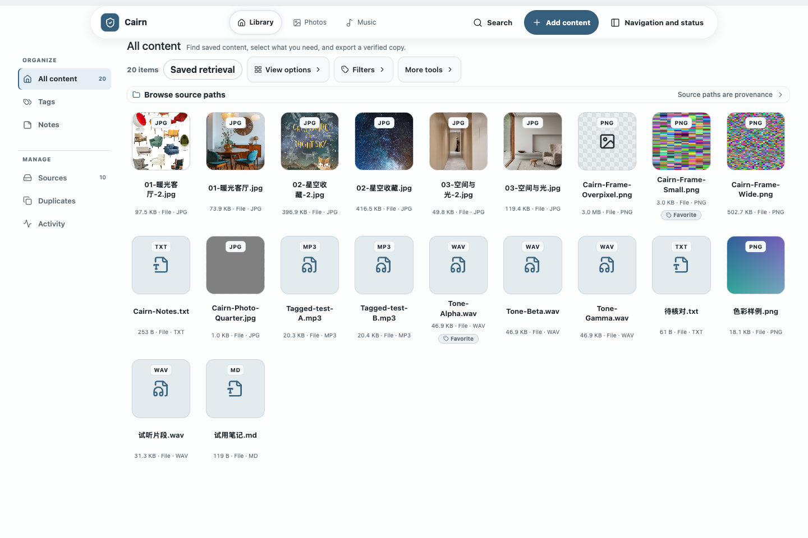
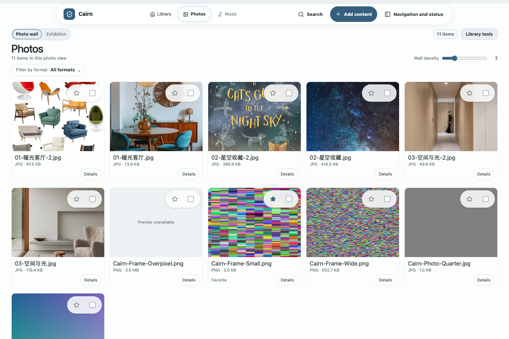
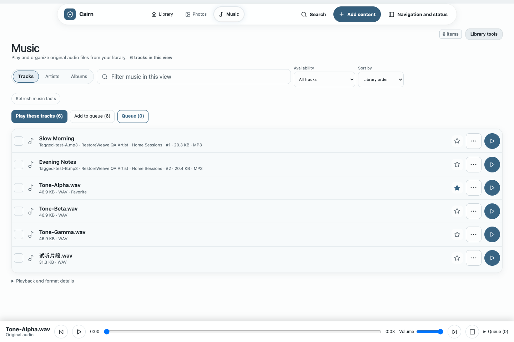
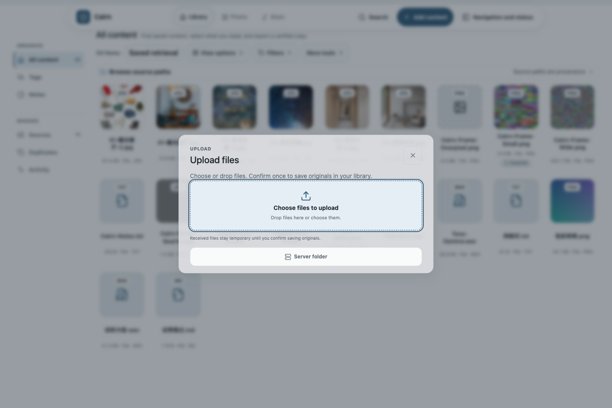

# Cairn

[中文](README.md) · [English](README.en.md)

<p align="center">
  <strong>A self-hosted personal drive, made for finding and using your files</strong><br>
  Keep it in your space. Find it, use it, take it with you.
</p>

<p align="center">
  <a href="#current-status"></a>
  <a href="LICENSE"></a>
  <a href="go.mod"></a>
</p>

> Cairn is for NAS and home-storage hobbyists: find your content, use it through Photos, Music and Library, or take out and verify the originals; existing built-in layouts and dedicated interfaces make daily work fit personal habits. File-first intake and exact deduplication support that loop. Current `main` is an unreleased development preview after `v0.1.0-prealpha.1`, not a production release. A supported installer, production repository qualification, LinkGroup, and complete multi-platform guarantees remain open.

<p align="center">
  
</p>
<p align="center"><sub>Demo content in the current local development preview.</sub></p>

[5-minute start](#5-minute-start) · [Core capabilities](#core-capabilities) · [Wiki](docs/wiki/README.md) · [Full documentation](docs/README.md) · [Changelog](CHANGELOG.md)

## Core capabilities

- **Find content:** keywords, structured filters, tags, and Notes work together; semantic search is available after an explicitly provisioned and verified local BGE bundle.
- **Find PDF/DOCX by body:** Find a document from remembered text; Details shows the matched paragraph and the exact original remains downloadable. Semantic matches use real local BGE when its bundle is installed and the index is current.
- **Find screenshots and photos by their text:** search for words or their meaning, read recognized text and quality in Details, then download the original. Explicitly install the local OCR and BGE models first; after saving, choose “Prepare search.” See [usage and scope](docs/technical/product-power-image-text-proposal.md).
- **Find photos by visual content:** describe a scene in Chinese, or use a saved photo to find similar images, view the result and take out its original. Explicit local CLIP installation and indexing are required; this is locally delivered in the Darwin arm64 development preview. See [local setup](docs/technical/product-power-visual-search-proposal.md#local-preparation-and-use).
- **Continuous slideshows and immersive listening:** show loaded photos at 3, 5, 10 or 20-second intervals, pause, loop or enter full-screen presentation. Open the full Music player for seek, volume, playback speed and queue controls, keeping the same playback state when you leave.
- **Use or take out originals:** work with content in Photos, Music or Library, download original files, or export and verify their bytes.
- **Make it your tool:** choose Workspace or Content showcase, then use dedicated interfaces such as Photos and Music in ways that fit your habits; over time, we hope to offer more ways to combine pages, layouts and presentations.
- **Keep context:** names, source paths, file facts, multiple tags, and one Notes surface stay with the content.
- **Organize once, reuse the result:** arrange material, user Notes and Skill instructions into an ordered list, review and save it, then reopen it to play supported audio in order, append it to the queue or take out unique originals together. Ordinary programs can read its JSON. Manual organization and explicit prompt/result handoff to an external AI use the same snapshot format. See the [guide](docs/wiki/material-lists.md).
- **Organize in batches:** add or remove tags and favorite selected content; Library, Photos and Music support range selection in their displayed order.
- **Easy intake:** choose or drop files, watch upload progress and stop when needed; a complete confirmed receipt prepares the batch for review before you confirm saving originals. Importing an existing NAS directory remains available.
- **Reduce duplicates:** SHA-256 of the complete content plus logical length identifies exact matches, so duplicate content is stored once.
- **Inspect storage:** explicitly open Settings → Storage for measured original-reference, unique-object, physical-byte, duplicate-reference comparison, and compression figures. Unknown categories are marked unmeasured, never shown as zero. Reference bytes count retained snapshot file references, not the current library's total files.

### Future directions

We want to make content easier to find, use and take out, then help each person shape the whole tool into something they enjoy using. Here are experiences we hope to expand beyond the current preview:

- Make the path from search to using or downloading an original feel more natural and take fewer steps.
- Continue the other Photos and Music journeys, including curated albums and persistent playlists that are not implemented, and give video a dedicated browsing and playback experience.
- Let people combine more pages, layouts and presentations into a tool they enjoy, beyond changing colors alone.

Different interfaces will continue to share the same content, tags and search, keeping originals and recovery records reliable.

Cairn keeps original files together with their descriptions, discovery, export and recovery in one self-hosted library. Photos and Music have dedicated interfaces; other files use the general Library for retrieval and takeout. Recognized file formats are not guaranteed to preview or play. Video does not yet have a dedicated media experience; see below. Daily organization centers on content, tags and discovery, with original directories retained as provenance and recovery references.

## One complete workflow

```text
configure your space once
→ choose/drop files or inspect a NAS directory
→ confirm saving originals
→ find files through search, favorites, tags and Notes
→ use the library, Photos or Music
→ download/export originals or restore and verify their bytes
```

## 5-minute start

For a local source preview, use Go 1.26 (or the version declared by `go.mod`), a Node.js version supported by Vite 7, npm and curl:

```bash
git clone https://github.com/ailiheizi/cairn.git
cd cairn
./scripts/run-local.sh --data-dir "$HOME/cairn-data"
```

Replace `$HOME/cairn-data` with the absolute directory where you want Cairn's configuration, library and recovery records; use one directory per instance. The first run creates the configuration, while an existing configuration and its persisted paths remain authoritative.

The script builds the daemon, CLI and WebUI, then starts the local service in the foreground; press `Ctrl-C` to stop it. Open `http://127.0.0.1:4538/`. The API listens on loopback only; do not expose it to the public network.

It does not download or install a semantic model bundle; semantic search availability depends on the existing configuration and supplied bundle. This is a local source preview, not a supported installer or release qualification.

<details>
<summary>Advanced: manually build the daemon and CLI, then start the development WebUI</summary>

```bash
go build -tags=cairn_zvec_dynamic -o bin/cairnd ./server/cmd/cairnd
go build -tags=cairn_zvec_dynamic -o bin/cairn ./client/cmd/cairn
bin/cairn config init --path ./cairn.toml
```

Enable the local WebUI API:

```toml
[api]
enabled = true
listen = "127.0.0.1:4534"
```

Start the daemon and frontend in separate terminals:

```bash
# Terminal 1
bin/cairnd --config ./cairn.toml --socket /tmp/cairnd.sock

# Terminal 2
cd web
npm ci
npm run dev
```

Open `http://127.0.0.1:5173/`. See the [Wiki quick start](docs/wiki/quick-start.md) for configuration, source inspection, and restore details.

</details>

## Real interface

These screenshots show the current local development preview.

<details>
<summary>Photos browsing and inspection</summary>

<p align="center"></p>
<p align="center"><sub>Demo content in the current local development preview.</sub></p>

The photo wall, continuous viewer and Exhibition share the current content scope. The viewer and Exhibition can select photos and return to the existing batch-action area; image reads stay within the current size and pixel budgets. When tags are available, click a photo card’s tag to filter the loaded photos while keeping the host search and selection. Open the card’s More actions menu to download its original. The current client batch extends the existing Exhibition with an explicit timed mode: advance through loaded photos every 3, 5, 10 or 20 seconds, pause, or choose looping; browser evidence also confirms Escape and focus return. Two Chinese scene prompts and an image query returned actual CLIP results; opening a match reached its viewer and host Details, and downloaded `a.jpg`/`c.jpg` originals matched independent SHA-256 and length records. Visual search requires an explicitly installed local CLIP image index; the first query does not download a model.
</details>

<details>
<summary>Music browsing and queue</summary>

<p align="center"></p>
<p align="center"><sub>Demo content in the current local development preview.</sub></p>

Sort the loaded Music list by recorded track facts and filter files eligible for a playback attempt. The transient queue supports append, insert-next, reorder, one-shot shuffle of upcoming tracks and repeat. Insert-next leaves the current track playing; browser decoding still depends on the audio format. The immersive listening layout keeps the same verified original and player state; browser evidence confirms the same audio element, Blob, paused position, transport controls, repeat, queue and focus return.
When Music-local filters or grouping hide the current track, one action clears those local conditions and locates it while retaining playback and selected files. A track outside the current loaded results gets an explicit explanation; global search is retained.
</details>

<details>
<summary>Add files</summary>

<p align="center"></p>
<p align="center"><sub>Demo content in the current local development preview.</sub></p>

Choose or drop files to prepare the current file list for review. Staging does not mean the files are saved; only explicit Save confirmation writes content into the protected library.
</details>

## Current status

The local development preview includes a photo wall, continuous viewer and Exhibition; photo inspection can select items and jump to the shared batch-action area. The 2026-10-20 client batch implemented and locally delivered explicit timed photo slideshows, immersive Music controls over the same original/player source, and real CLIP retrieval by scene text or a photo. Retained browser evidence passed slideshow and Music continuity, two Chinese scene queries, image-to-image retrieval, opening the matching viewer and host Details, and independent SHA-256/length checks for `a.jpg` and `c.jpg`; the 390 px viewport had no horizontal overflow. Final served assets match the delivered candidate, and the promotion postcheck passed. CLIP is installed only in a private development instance; redistribution-license review remains pending. Music browses tracks and recorded artist/album facts, sorts and filters the loaded list for original playback attempts, and controls a transient queue. Insert-next places a track after the current one without restarting playback; the queue also supports append, reorder, one-shot shuffle of upcoming tracks and repeat. Unknown facts stay last or in an unknown group, and browser decoding is not guaranteed. Pages and whole interfaces are registered through compiled in-repository code. The local CLIP image generation was READY with 11 indexed originals. The accompanying lexical rebuild remained DEGRADED with six missing fields (`duplicates`, `duplicate_group`, `locators`, `notes`, `descriptions`, `language`); this is not complete Phase 4 coverage.

The wall and Exhibition are Photos presentations over the same search/tag results. Selection in the photo viewer and Exhibition is shared with the existing batch-action area. Music presents tracks and recorded audio facts within the same returned-result scope. Workspace and Content showcase are a separate whole-interface layout layer. Pages and layouts use in-repository code compiled into the first-party client; there is no runtime third-party package loader or isolation boundary.

Shift-click in Library, Photos and Music selects an inclusive range in that page's currently displayed order. Hidden filtered items stay unselected, and existing selections from other pages remain. The batch summary keeps selected count and known file size visible; type details expand on demand, while folders, other items, unknown sizes and unresolved selections retain explicit notices. More actions can copy selected filenames or recorded source paths as one quoted raw value per line, preserving distinct items with duplicate names; source paths describe provenance, not current storage locations. Batch add reuses an exact existing tag on a selected item, and remove affects matching `TAG` records only, preserving other tags and Notes. Stars and the shared Only favorites filter in Photos, Music and Content overview use the ordinary visible `Favorite` tag. This is a daily tag shortcut, not album or playlist membership. Each change does not immediately create a new signed portable backup. Fuller album and playlist experiences are part of the future direction above.

Content overview combines photos, audio and other content within the same search/tag scope, with shared selection, Details and playback. Each section previews at most six items and distinguishes displayed counts from scope totals; domain switches do not rerun search. Library and Overview expose the existing Saved retrieval panel directly; Photos and Music retain it in Library tools. Ordinary Library retrieval can save user tags alone or combine them with submitted, supported keywords and structured conditions. Multiple tags must all match their complete original values exactly. Local media display choices and other unsupported active conditions are refused. Recall evaluates current content and discloses empty, degraded or foreign-scope results. Tag/structured-only retrieval does not require semantic keyword material and is not degraded merely because no query text was supplied; a component actually required by the request still reports when unavailable. Freeze an export manifest when a fixed file set is needed. Curated albums and durable playlists have a [candidate design](docs/technical/durable-media-organization-design.md) but remain unimplemented. See the [overview acceptance](docs/technical/fixed-overview-acceptance-20261009.md) and [tag retrieval implementation](docs/technical/daily-client-functions-acceptance-20261018.md#exact-user-tags-in-existing-savedviews--2026-10-18).

Selected originals can be downloaded in one ZIP with per-file identity checks, progress and cancellation. Photos and Exhibition provide transient PNG/JPEG thumbnails up to 8 MiB/12 million pixels and direct large-image inspection. The ZIP budget is 32 files, 32 MiB per file and 64 MiB total; larger takeout retains single-original downloads and server-directory export. Explicit image inspection remains capped at 8 MiB and original audio playback at 32 MiB. Richer photo facts and thumbnails, Music artwork and mobile experiences remain future directions.

### Video and other files

Video files currently use the general Library for preservation, search and original takeout; there is no dedicated video library or playback. Preview of other formats depends on actual support. A dedicated video experience is a future direction above.

PDF/DOCX body extraction covers new captures and ordinary explicit recaptures. Inputs are capped at 16 MiB and extracted text at 1 MiB; scanned, encrypted or unsupported documents keep their originals but yield no searchable body text. There is no scanned-PDF OCR or PDF/Word reader, and rebuilding the index alone does not extract existing captures. See the [bounded document-search profile](docs/technical/product-power-content-search-proposal.md).

TXT/MD and other supported text records expose valid HTTP(S) references in the existing preview for explicit new-tab reading, preserving the original text, order and bytes. The 64 KiB text cap remains; links do not fetch or archive page contents automatically. UI search, reference activation, exact original download and two-record ZIP takeout have [local journey evidence](docs/technical/composed-text-references-acceptance-20261014.md).

Add content also offers “Paste text into a .txt file”: save up to 64 KiB of literal text or references through the same upload, review and confirmation flow. Drafts remain in the current page session. Existing-record editing, grouped webpage capture and automatic reopening remain future capabilities. Saved retrieval reports the loaded count and warns at the 200-item ceiling that more matches may exist. Opening a saved retrieval is a bounded preview; “Export this saved search” freezes the complete current matching file set on the server, independent of the preview count. That export writes to a server directory, not a browser ZIP. ZIP takeout remains limited to explicitly selected files: 32 files, 32 MiB each and 64 MiB total.

These Photos/Music and takeout capabilities are part of the local [RW-PERSONAL-UX-1](docs/requirements/first-party-client-experiences.md) development scope; the full product and release qualification remain unfinished. See [ADR-027](docs/technical/build-stack-and-architecture-selection.md#adr-027-frozen-original-zip-takeout-and-transient-ordinary-photo-renditions), the [extension contribution guide](docs/technical/client-experience-extension-guide.md) and [current acceptance](docs/technical/takeout-photo-acceptance-20261009.md).

### Implemented and tested (current development profile)

- TOML configuration, explicit data paths, source inspection, protection plans, and confirmed writes.
- SHA-256 + length identity, exact whole-file deduplication, Notes, multiple user tags, and keyword/structured search.
- Real BGE-small-zh + ONNX + zvec components run with an explicitly provisioned bundle; without one, the service honestly degrades to ordinary search.
- SavedView, ExportManifest, materialize/verify, signed recovery, clean reader, tamper rejection, migration, and cross-process safety evidence for the local development scope.
- Library batch organization: idempotently add tags to captured selections, remove matching tags, favorite/unfavorite in batches, and select inclusive ranges in ordinary displayed row order.
- Local Photos/Music slices: selection shared from photo inspection to batch actions, recorded artist/album browsing, bounded identity-checked original playback, loaded-list Music sorting/eligibility filters, and transient queue append/insert-next/order/shuffle/repeat. Fuller photo and music journeys are described under Future directions.
- Library and Overview directly open existing SavedView retrieval; Photos/Music keep it in Library tools. Supported queries recall dynamically, with visible refusals, empty/degraded outcomes and foreign stored scopes.
- Photos, Music and Content overview share the existing `Favorite` TAG star and filter. It creates no album/playlist membership and does not promise an immediate signed backup on each click.
- React WebUI and the loopback `/api/v1` convenience adapter, with responsive layout and Chinese localization.
- Settings → Appearance switches between bundled Workspace and Content showcase layouts over shared content, search, and Notes; palettes are independent secondary choices. See the [local acceptance record](docs/technical/client-interface-experiences-acceptance-20261006.md).

Image OCR is locally delivered in the Darwin arm64 preview: an operator explicitly installs and verifies the PP-OCR bundle, restarts the daemon, then captures a new image or uses the ordinary explicit recapture flow and explicitly prepares the search index. Existing lexical and local BGE retrieval can find recognized text or its meaning; Details shows recognized text, source and quality, and the exact original remains available. A real OCR/BGE browser journey passed locally; this does not qualify other platforms or a release. Existing images are not automatically reprocessed. The separate VIS-1/2/3 Chinese-CLIP delivery is admitted; its bundle is installed only in a private development instance, and retained browser evidence confirms actual text/image retrieval and matching original bytes. The matching-photo viewer and host Details are covered by the same local browser acceptance; upstream license conversion has not been separately asserted and redistribution review is pending. Scanned-PDF OCR remains outside this image-text delivery. See the [image-text search record](docs/technical/product-power-image-text-proposal.md), [VIS-1/2/3 proposal](docs/technical/product-power-visual-search-proposal.md), and [module and installation design](docs/technical/personal-information-modules-and-installation-design.md#search-spaces-and-evidence).

### Core qualification and technical boundaries

- `local-zstd-v1` is a runnable whole-file compression candidate, not a production repository; Restic/Kopia/Plakar have not been selected as a default engine.
- Supported offline installers, cross-platform distribution, upgrade/backup workflows, and production qualification still require independent evidence.
- LinkGroup is the minimal file-link grouping primitive in the core plan; it can enter Phase 6 only after the existing Phase 4/5 gates, and has no user-visible version history or complete workflow today.
- Image CLIP/SigLIP, acoustic indexing, RWKV/Transformer compression, and destructive GC are not part of the current default core; reachability remains `NON_DESTRUCTIVE_ONLY`.

“Implemented and tested” means evidence for the stated checkout scope, not production support. See the [content, deduplication, search, and export contract](docs/requirements/content-store-views-and-exports.md) and the [core execution plan](docs/technical/core-mvp-execution-plan.md) for the complete status matrix.

## Go deeper

- [Wiki overview](docs/wiki/README.md): plain-language guidance for daily use and boundaries.
- [Detailed capability reference](docs/wiki/capability-reference.md): configuration, storage, search, Notes, recovery, and status details.
- [Quick start](docs/wiki/quick-start.md) · [Storage and capacity](docs/wiki/storage-and-capacity.md) · [Index status and search](docs/wiki/index-status-and-search.md) · [Recovery and boundaries](docs/wiki/recovery-and-boundaries.md)
- [Documentation map](docs/README.md): requirements, ADRs, technical plans, and qualification records.
- [Content Store, Views, and Export Requirements](docs/requirements/content-store-views-and-exports.md) · [Core MVP Execution Plan](docs/technical/core-mvp-execution-plan.md)
- [Changelog](CHANGELOG.md)

## License

The source is available under the [MIT License](LICENSE). Model weights, tokenizers, ONNX Runtime, zvec, third-party dependencies, and future install bundles retain their own licensing and redistribution terms.
