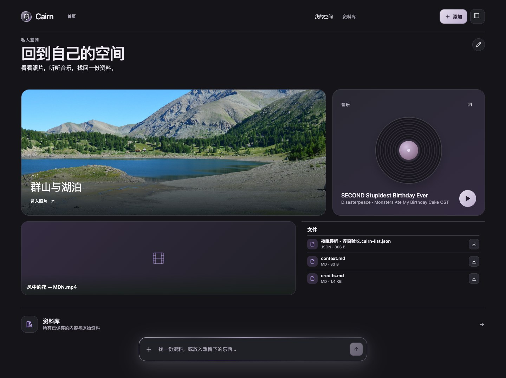
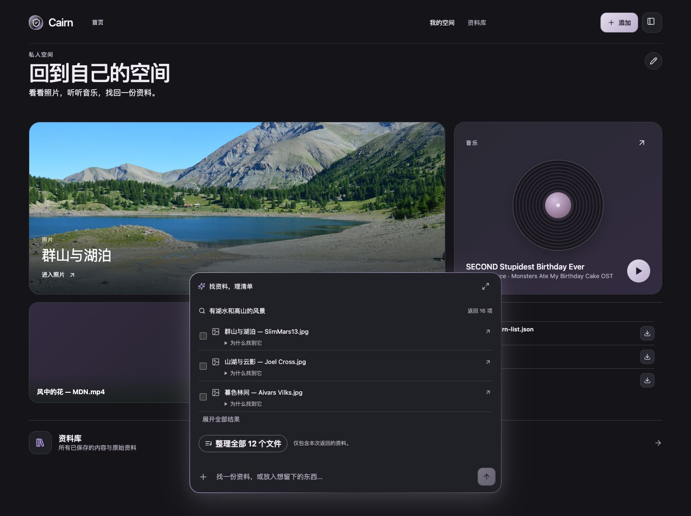
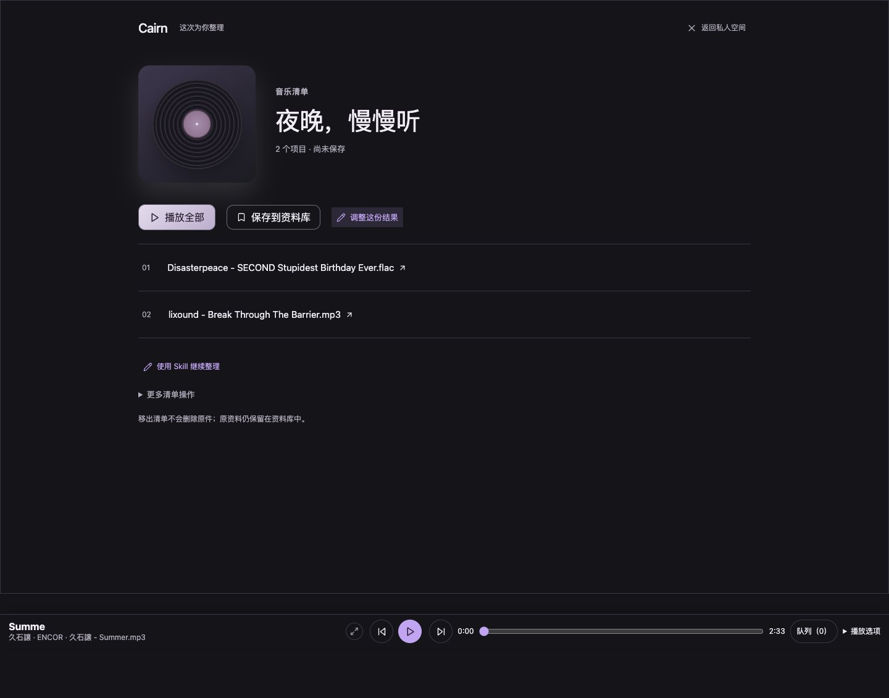
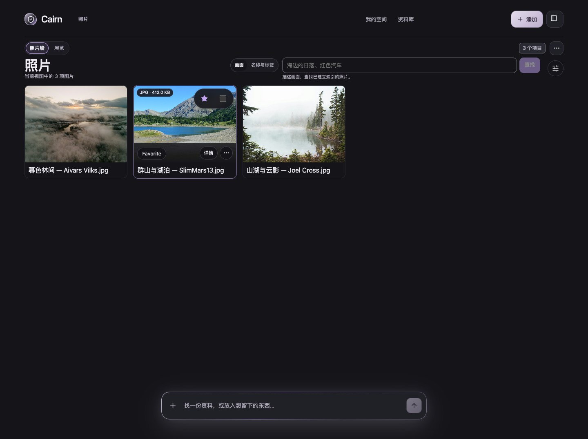
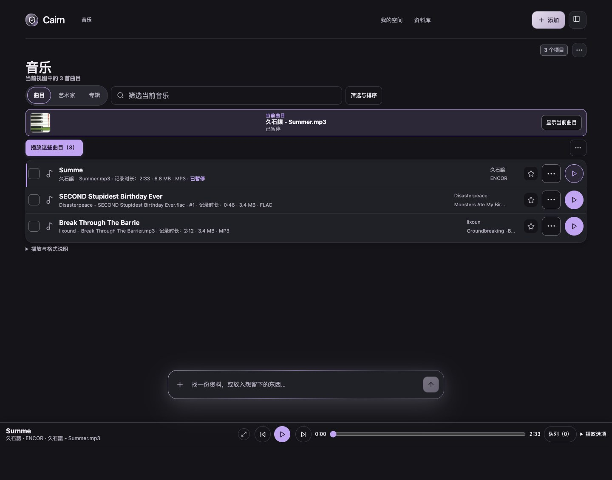
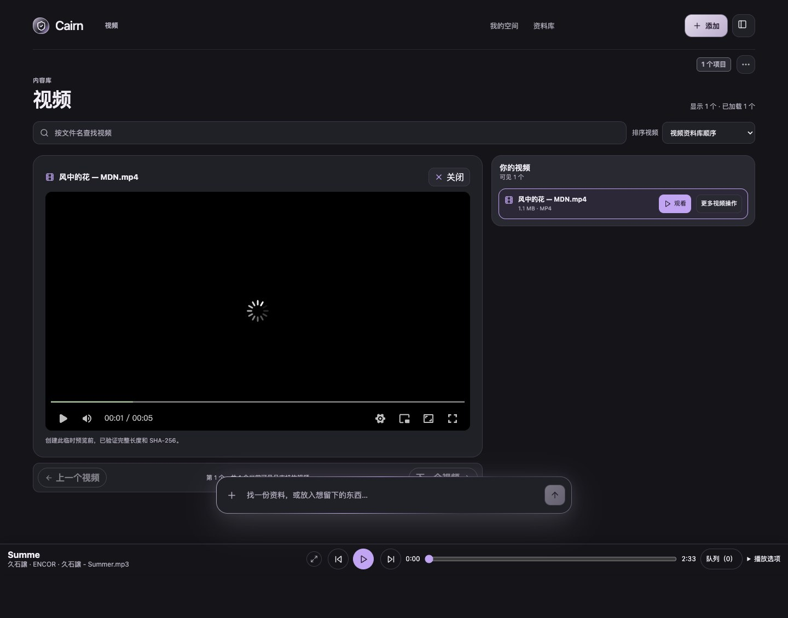

# Cairn

[中文](README.md) · [English](README.en.md)

<p align="center">
  <strong>让存下的内容，随时找得到、用得上。</strong><br>
  一个可自部署的 AI 个人内容空间。
</p>

<p align="center">
  <a href="LICENSE"></a>
  <a href="#当前状态"></a>
</p>

<p align="center">
  
</p>
<p align="center"><sub>当前本地预览的真实界面，中文展示；也可切换英文。演示内容及媒体来源见<a href="docs/assets/screenshots/current/README.md">截图说明与致谢</a>。</sub></p>

[5 分钟启动](#5-分钟启动) · [核心能力](#核心能力) · [Wiki](docs/wiki/README.md) · [完整文档](docs/README.md)

## 核心能力

| | Cairn 帮你 |
|---|---|
| **存入** | 文件、文件夹或文字走同一审阅保存流程；中途关闭后可继续审阅，停止后可明确重试。原件按完整内容 SHA-256 与逻辑长度识别精确重复。 |
| **找到** | 在底部浮窗用关键词、结构条件、标签和 Notes 找资料；显式准备本地模型后，可按意思或照片画面检索。命中依据按需展开。 |
| **使用** | 点击结果进入照片、音乐或视频专属页并定位；播放、取原件与保存结果都复用同一份资料。 |
| **原件** | 下载原件，或使用现有导出流程生成并校验文件；需要恢复时可验证原始字节。 |
| **用成自己的工具** | 在“工作台”和“内容展厅”两种内置整体界面间选择；Home 可调整现有区块的显示，并调整 Photos／Music 的顺序和分栏。详见[编译式界面贡献指南](docs/technical/client-experience-extension-guide.md)。 |
| **清单** | 保存普通 JSON 资料清单，带上备注与 Skill 上下文；按需生成并审阅整理候选，再用现有流程确认保存。 |

### 从找到，到用起来

1. **先存一份东西**：拖入文件、选择文件夹，或留下一段文字；审阅后确认保存。完成后直接查看这次保存的文件。
2. **说出你记得的线索**：底部浮窗先给相关资料，需要时再看“为什么找到它”。点击跨范围的媒体结果后，进入这次搜索的专属页面。
3. **拿去用，再留下结果**：打开、播放或取出原件；也可以把选择整理成清单，调整顺序、审阅保存，以后重开继续用。

<p align="center">
  
  
</p>
<p align="center"><sub>查询和查看依据时保持背景页面；明确打开结果时才切换范围。清单继续保存为普通资料。</sub></p>

### 专属界面

<p align="center">
  
  
</p>
<p align="center"><sub>Photos 与 Music 使用当前已加载的内容范围和共享操作。</sub></p>

<p align="center">
  
</p>
<p align="center"><sub>Videos 提供已加载文件的浏览；显式播放时，先完整校验不超过 32 MiB 的 MP4／WebM 原件，再交给内置播放器。</sub></p>

照片可在查看器中连续浏览或按间隔放映。Music 提供曲目浏览、暂态队列和共享播放器；支持的音频原件在验证后播放，大小上限为 32 MiB。支持播放的曲目可显示其原件内嵌封面。无法在浏览器中播放或超过上限的视频仍可查看详情、下载原件；当前不提供流媒体或转码。

### Notes、搜索与清单

名称、来源路径、已有文件事实、用户标签和 Notes 帮助找回资料。PDF／DOCX 正文检索使用编译在应用中的正文提取。语义搜索需要显式准备本地 BGE；图片 OCR 和照片画面检索也分别需要显式准备对应本地处理包或模型，首次查询不会下载它们。清单可由程序直接读取，也可在结果页重开，播放受支持的音频或取出对应的唯一原件。内置 AI 整理使用明确选定的清单与 Skill，先产生候选，再由你接受并确认保存。

详见[清单使用说明](docs/wiki/material-lists.md)和[详细能力参考](docs/wiki/capability-reference.md)。

## 5 分钟启动

本机源码预览需要 Go 1.26（或 `go.mod` 声明的版本）、Vite 7 支持的 Node.js、npm 和 curl：

```bash
git clone https://github.com/ailiheizi/cairn.git
cd cairn
./scripts/run-local.sh --data-dir "$HOME/cairn-data"
```

把 `$HOME/cairn-data` 换成你希望存放 Cairn 配置、资料库和恢复记录的绝对路径；每个实例使用一个目录。首次运行会创建配置，已有配置和其中保存的路径保持原样。

脚本在前台构建 daemon、CLI 和 WebUI，并启动本机服务；按 `Ctrl-C` 停止。打开 `http://127.0.0.1:4538/`。API 仅监听 loopback，不要暴露到公网。

脚本不会下载或安装语义模型包；语义搜索是否可用取决于现有配置和已提供的 bundle。此入口是本机源码预览，不代表受支持的安装包或发布资格。

<details>
<summary>高级：手动构建 daemon、CLI 并启动开发 WebUI</summary>

```bash
go build -tags=cairn_zvec_dynamic -o bin/cairnd ./server/cmd/cairnd
go build -tags=cairn_zvec_dynamic -o bin/cairn ./client/cmd/cairn
bin/cairn config init --path ./cairn.toml
```

在配置中启用本机 WebUI API：

```toml
[api]
enabled = true
listen = "127.0.0.1:4534"
```

分别启动 daemon 和前端：

```bash
# 终端 1
bin/cairnd --config ./cairn.toml --socket /tmp/cairnd.sock

# 终端 2
cd web
npm ci
npm run dev
```

打开 `http://127.0.0.1:5173/`。完整配置、来源检查和恢复步骤见 [Wiki 快速开始](docs/wiki/quick-start.md)。

</details>

## 当前状态

Cairn 当前是本地开发预览，不是正式发行版。界面和可用能力以当前源码、配置及本机已安装的模型为准；部分检索能力需要分别准备本地 bundle。此预览不代表生产仓库资格、完整多平台支持或正式发布安装包。视频、音频播放均受文件格式、大小上限和实际浏览器支持限制。

图片 OCR 与照片画面检索需显式安装对应本地 bundle；Darwin arm64 开发配置中的真实检索已有本地交付证据。上游模型与依赖有各自的授权和分发条款。详细能力边界与证据见[能力参考](docs/wiki/capability-reference.md)、[图片文字检索说明](docs/technical/product-power-image-text-proposal.md)和[视觉检索说明](docs/technical/product-power-visual-search-proposal.md)。

### 未来方向

后续方向包括更多个人化的页面组合、更大媒体的播放，以及策展相册和持久歌单；这些仍是未来方向。

## 深入文档

- [Wiki 概览与快速开始](docs/wiki/README.md) · [能力参考](docs/wiki/capability-reference.md)
- [资料清单](docs/wiki/material-lists.md) · [存储与容量](docs/wiki/storage-and-capacity.md) · [搜索与索引状态](docs/wiki/index-status-and-search.md) · [恢复与边界](docs/wiki/recovery-and-boundaries.md)
- [文档地图](docs/README.md) · [内容、去重、搜索与导出要求](docs/requirements/content-store-views-and-exports.md) · [核心实施顺序](docs/technical/core-mvp-execution-plan.md)
- [截图与媒体致谢](docs/assets/screenshots/current/README.md) · [变更记录](CHANGELOG.md)

## 许可

源码采用 [MIT License](LICENSE)。模型、分词器、ONNX Runtime、zvec、第三方依赖和安装包各自适用其授权及分发条款。
