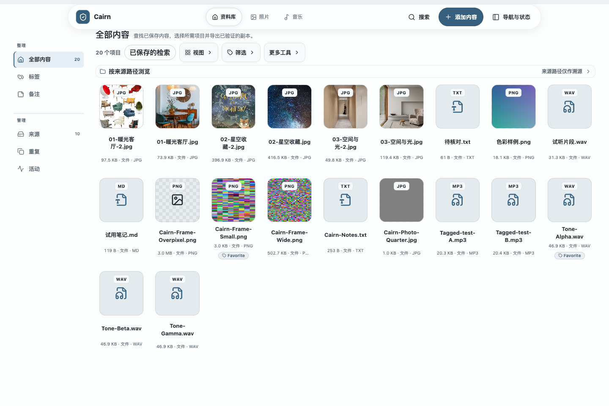
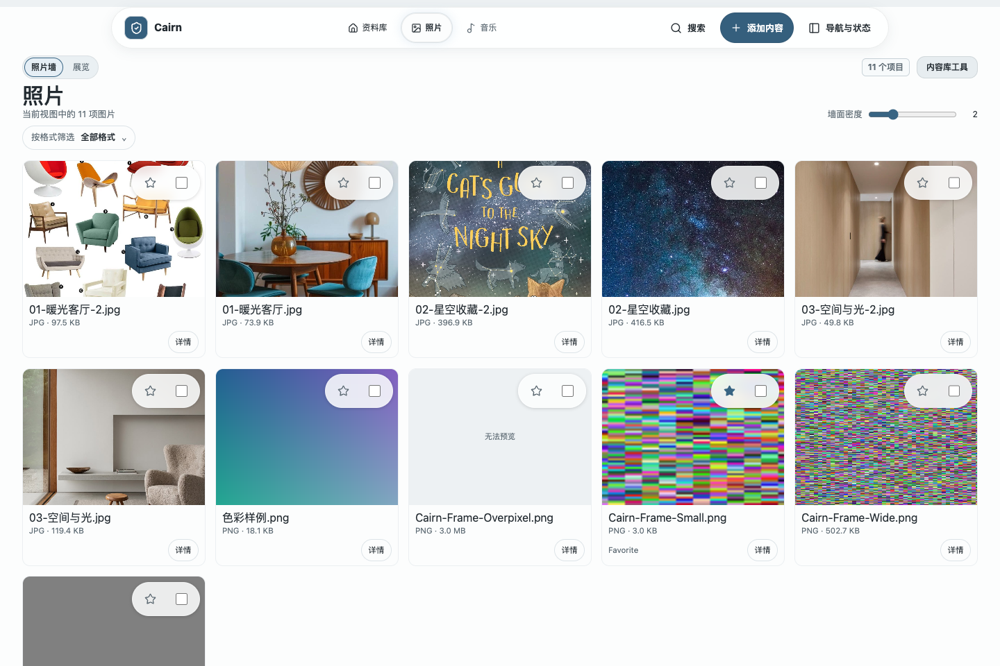
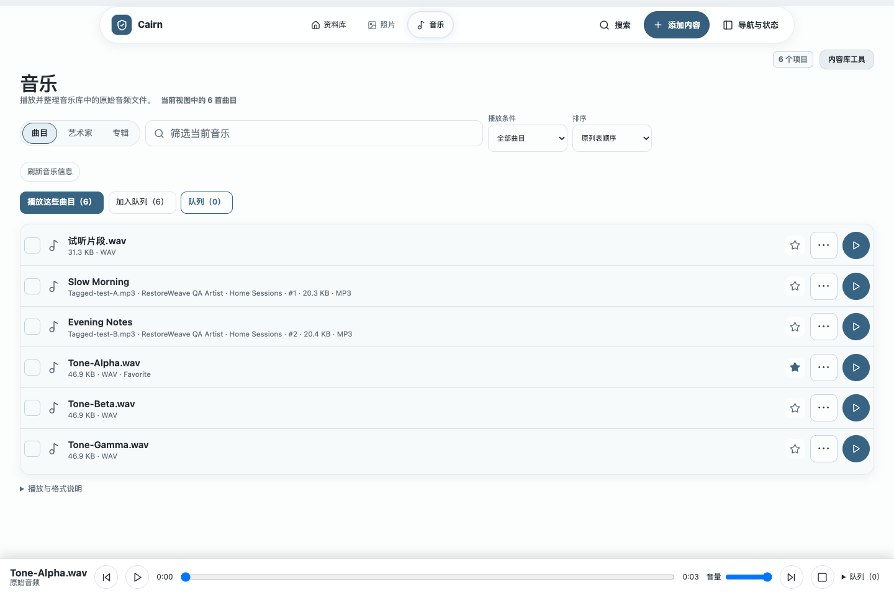
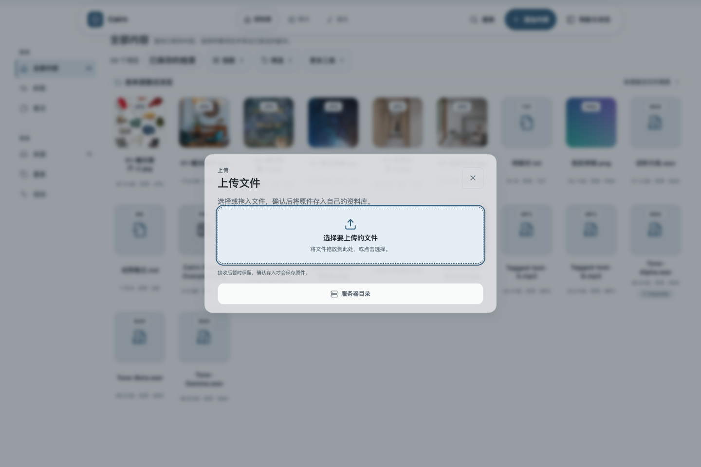

# Cairn

[中文](README.md) · [English](README.en.md)

<p align="center">
  <strong>自部署、更好用的私人网盘</strong><br>
  存进自己的空间，找得到、用得上、带得走。
</p>

<p align="center">
  <a href="#当前状态"></a>
  <a href="LICENSE"></a>
  <a href="go.mod"></a>
</p>

> Cairn 面向 NAS 与家庭存储爱好者：先找到自己的内容，再通过照片、音乐和资料界面使用它们，或带走并校验原件；现有内置布局和专属界面让日常操作更贴合个人习惯。选择文件存入和精确去重支撑这条主线。当前 `main` 是 `v0.1.0-prealpha.1` 之后的未发行开发预览，不是生产发行版。正式安装包、生产仓库资格、LinkGroup 和完整多平台发行保证仍在后续阶段。

<p align="center">
  
</p>
<p align="center"><sub>当前本地开发预览中的演示资料。</sub></p>

[5 分钟启动](#5-分钟启动) · [核心能力](#核心能力) · [Wiki](docs/wiki/README.md) · [完整文档](docs/README.md) · [变更记录](CHANGELOG.md)

## 核心能力

- **找到内容**：关键词、结构化条件、标签和 Notes 一起检索；显式安装并校验本地 BGE bundle 后还可使用语义搜索。
- **按正文找 PDF／DOCX**：记得正文内容即可查找文件；详情展示匹配段落，原件仍可下载。安装了本地 BGE bundle 且索引为当前版本时，也可按含义查找。
- **按图中文字找回截图和照片**：用图片里的关键词或文字含义找回原图，在详情阅读识别文字、查看质量，再下载原件。首次需显式安装本地 OCR 与 BGE 模型；保存后点击“准备搜索”。详见[使用方式与范围](docs/technical/product-power-image-text-proposal.md)。
- **按画面找照片**：输入「客厅里的白色沙发」，或用已有照片找相似图片，查看结果并取回原图。需显式安装本地 CLIP 模型并建立索引；目前已在 Darwin arm64 开发预览交付。[使用说明](docs/technical/product-power-visual-search-proposal.md#local-preparation-and-use)。
- **连续放映与沉浸聆听**：照片可按 3、5、10 或 20 秒放映，支持暂停、循环和全屏；音乐可进入完整播放器，操作进度、音量、倍速及队列，退出后保留当前播放状态。
- **使用或带走原件**：在照片、音乐或资料界面使用内容，下载原始文件，或导出并校验文件字节。
- **用成自己的工具**：选择工作台或内容展厅，在照片、音乐等专属界面中按自己的习惯使用内容；未来希望进一步丰富页面、布局与展示方式的组合。
- **保留上下文**：名称、来源路径、文件事实、多个标签和一个 Notes 界面随内容保留。
- **整理一次，重复使用**：将资料、用户备注和 Skill 说明整理成有序清单，审核保存后可重新打开，按顺序播放支持的音频、追加到队列或整组取出不重复原件；普通程序也能直接读取 JSON。支持手动整理及向外部 AI 复制提示词、导回结果。当前保存结果快照。[使用说明](docs/wiki/material-lists.md)。
- **批量整理**：添加或移除标签、批量收藏；资料库、照片和音乐都支持按各自实际显示顺序扩展选择范围。
- **轻松存入**：选择或拖入文件，查看上传进度，必要时停止上传；整批文件接收确认后自动准备文件清单，确认后保存原件。也可导入 NAS 上已有的目录。
- **减少重复**：以完整内容的 SHA-256 和逻辑长度识别相同文件，重复内容只保存一份。
- **查看存储报告**：在“设置 → 存储”显式查看已测量的原件引用、唯一对象、物理字节、重复引用对比和压缩字节；未知项目会明确标为未测量，不会显示成零。引用字节按保留的快照文件引用计算，不代表当前文件总量。

### 未来方向

我们希望让内容更容易找到、使用和带走，再逐步把整个工具调成个人喜欢且顺手的样子。以下是接下来希望拓展的体验，尚未包含在当前预览中：

- 让从搜索到使用或下载原件的过程更自然、更省步骤。
- 继续完善 Photos 与 Music 的其他旅程，包括尚未实现的策展相册、持久歌单；为视频提供专属浏览与播放体验。
- 让用户能把更多页面、布局与展示方式组合成自己喜欢的工具，而不只是更换配色。

不同界面仍共享同一份资料、标签和搜索，让原件与恢复记录保持可靠。

Cairn 把文件原件与描述、发现、导出和恢复放在一个自托管内容库中。照片和音乐已有专属界面，其他文件通过通用资料库检索和取出。可识别格式不代表一定能预览或播放；视频目前没有专属影视体验，见下文。日常组织以内容、标签和检索为中心；原始目录保留为来源和恢复依据。

## 一次使用流程

```text
首次配置自己的存储位置
→ 选择或拖入文件，也可导入 NAS 目录
→ 核对本次文件，确认存入
→ 搜索、收藏、加标签、写备注
→ 在照片、音乐或资料界面使用
→ 下载原件，或导出、恢复并校验
```

## 5 分钟启动

本机源码预览需要 Go 1.26（或 `go.mod` 声明的版本）、Vite 7 支持的 Node.js、npm 和 curl：

```bash
git clone https://github.com/ailiheizi/cairn.git
cd cairn
./scripts/run-local.sh --data-dir "$HOME/cairn-data"
```

把 `$HOME/cairn-data` 换成你希望存放 Cairn 配置、资料库和恢复记录的绝对路径；每个实例使用一个目录。首次运行会创建配置，已有配置和其中保存的路径保持原样。

脚本在前台构建 daemon、CLI 和 WebUI，并启动本机服务；按 `Ctrl-C` 停止。打开 `http://127.0.0.1:4538/`。API 仅监听 loopback，不要暴露到公网。

脚本不会下载或安装语义模型包；语义搜索是否可用取决于现有配置和已提供的 bundle。此入口是本机源码预览，不代表受支持的安装包或发布资格。

<details>
<summary>高级：手动构建 daemon、CLI 并启动开发 WebUI</summary>

```bash
go build -tags=cairn_zvec_dynamic -o bin/cairnd ./server/cmd/cairnd
go build -tags=cairn_zvec_dynamic -o bin/cairn ./client/cmd/cairn
bin/cairn config init --path ./cairn.toml
```

在配置中启用本机 WebUI API：

```toml
[api]
enabled = true
listen = "127.0.0.1:4534"
```

分别启动 daemon 和前端：

```bash
# 终端 1
bin/cairnd --config ./cairn.toml --socket /tmp/cairnd.sock

# 终端 2
cd web
npm ci
npm run dev
```

打开 `http://127.0.0.1:5173/`。完整配置、来源检查和恢复步骤见 [Wiki 快速开始](docs/wiki/quick-start.md)。

</details>

## 真实界面

以下截图来自当前本地开发预览。

<details>
<summary>照片浏览与检查</summary>

<p align="center"></p>
<p align="center"><sub>当前本地开发预览中的演示资料。</sub></p>

照片墙、连续查看和展厅共用当前内容范围。查看器与展厅支持选择照片，并返回现有批量操作区域；图片读取仍受当前大小和像素预算限制。标签可用时，点击照片卡片上的标签就能筛选已加载的照片，保留当前搜索和选择；展开卡片“更多操作”即可下载原件。 本轮扩展现有展厅的显式定时放映：按 3、5、10 或 20 秒推进已加载照片，可暂停、选择循环，并以沉浸方式展示；浏览器检查通过放映、暂停/循环、Escape 和焦点返回。按画面搜索的两条中文场景描述和以图搜图均返回实际 CLIP 结果，点击匹配项可打开 viewer 与 host Details；a.jpg/c.jpg 原件长度与 SHA-256 匹配独立输入记录。CLIP 图像索引需显式安装和构建，首次搜索不会下载模型。
</details>

<details>
<summary>音乐浏览与队列</summary>

<p align="center"></p>
<p align="center"><sub>当前本地开发预览中的演示资料。</sub></p>

音乐列表可按已有曲目事实排序，并筛选可尝试原件播放的项目。队列支持追加、插到当前曲目之后、排序、单次随机播放后续曲目和循环；插入下一首不会打断当前曲目。浏览器是否能解码仍取决于音频格式。 本轮的沉浸聆听布局沿用同一个已验证原件和播放器状态；本地浏览器确认进入/退出前后音频元素、Blob、暂停位置不变，音量、倍速、循环、队列及焦点返回可用。
当前曲目被音乐页筛选或分组隐藏时，可以一键清除音乐页筛选并定位，保留播放状态和已选文件。若曲目不在当前资料结果中，会明确提示，不会替你清除全局搜索。
</details>

<details>
<summary>添加文件</summary>

<p align="center"></p>
<p align="center"><sub>当前本地开发预览中的演示资料。</sub></p>

选择或拖入文件后，添加流程会准备本次文件清单供核对；暂存不代表已保存。只有用户明确确认保存，内容才会写入受保护资料库。
</details>

## 当前状态

当前本地开发预览包含照片墙、连续查看和展厅；照片检查可选择项目并跳转至共用批量操作区。2026-10-20 客户端批次已实现并在 Darwin arm64 本地交付显式定时照片放映、沿用现有原件与队列的沉浸音乐布局和真实 CLIP 画面检索。浏览器记录通过放映、Music 连续性、两条中文场景查询、以图搜图、打开匹配项 viewer/host Details，以及 a.jpg/c.jpg 原件长度和 SHA-256 校验；390 px 视口无横向溢出。最终交付索引与 served assets 匹配，postcheck 通过。CLIP bundle 仅在私有开发实例安装，分发许可审查仍待完成。音乐浏览曲目及服务已有的艺人／专辑事实，可对已加载列表排序、筛选符合原件播放尝试条件的项目，并操作暂态队列。插入下一首会放在当前曲目之后且不重启当前播放；队列支持追加、排序、单次随机播放后续曲目和循环。未知事实保留在末尾或未知分组，浏览器解码不作保证。页面及完整界面通过项目内编译注册，默认保持简单。 CLIP 图像索引在本地为 READY，纳入 11 个原件；同期词法重建仍为 DEGRADED，缺少 duplicates、duplicate_group、locators、notes、descriptions、language 六项字段，不能据此宣称 Phase 4 覆盖完整。

照片墙与展厅是“照片”下的展示方式，共用当前搜索和标签结果；照片查看器和展厅中的选择会联动到同一批量操作区。“音乐”在同一已返回结果范围内呈现曲目和已有音频标签。工作台与内容展厅是另一层整体界面布局。页面和布局由项目内代码编译注册，不提供运行时第三方插件加载或安全隔离。

资料库、照片和音乐页支持 Shift 点击，在各自当前显示的顺序内选择包含首尾的范围。筛选隐藏的项目不会因此被选中，其他页面已有的选择仍会保留。批量选择摘要常驻显示所选数量和已知文件大小，类型明细可展开查看；目录、其他项目、未知大小和失效选择仍有明确提示。“更多操作”可复制所选文件名清单或记录的来源路径清单，每行用引号保留原值，同名的不同项目分别保留；来源路径是溯源信息，不是当前存储位置。批量添加标签会复用所选内容上已存在的同名标签，移除只作用于匹配的 `TAG`，保留其他标签与 Notes。照片、音乐和分类总览中的星标与“仅看收藏”共用可见的 `Favorite` 用户标签。它是日常标签捷径，不是相册或歌单；标记不会立即生成新的签名便携备份。更完整的相册与歌单体验见“未来方向”。

“分类总览”可在同一搜索／标签范围内一起浏览照片、音频和其他资料，直接选择、打开详情或使用共享播放器。每个分区最多展示六项，并区分展示数量与当前范围数量；切换至照片或音乐不重新搜索。资料库和分类总览可直接访问“已保存的检索”；照片和音乐需从资料库工具入口打开。普通资料库可以保存纯用户标签检索，也可将标签与已提交、受支持的关键词／结构化条件组合；多个标签按完整原值精确匹配，并且必须同时满足。照片／音乐的局部显示选择及其他不支持的活动条件会被明确拒绝。召回根据当前资料重新求值，并显示空结果、降级或不同存储范围；纯标签／结构条件不要求语义关键词材料，不会仅因没有查询文本而降级；本次检索实际需要的组件若不可用，仍会明确提示。需要固定文件集合时再冻结导出清单。相册与持久歌单已有[候选设计](docs/technical/durable-media-organization-design.md)，尚未实现。详见[总览验收](docs/technical/fixed-overview-acceptance-20261009.md)及[标签检索实现记录](docs/technical/daily-client-functions-acceptance-20261018.md#exact-user-tags-in-existing-savedviews--2026-10-18)。

所选原件可以下载为逐文件校验的 ZIP，支持进度和取消；照片墙和展厅支持 8 MiB／1200 万像素以内的 PNG、JPEG 临时缩略图，并可直接查看大图。ZIP 当前限 32 个文件、单文件 32 MiB、合计 64 MiB；更大的内容仍可单独下载原件或导出至服务器目录。显式图片查看限 8 MiB，音频原件播放限 32 MiB。更丰富的照片事实与缩略图、音乐封面和移动端体验属于未来方向。

### 视频与其他文件

视频文件目前通过通用资料库进行保存、搜索和原件取出，尚无专属影视资料库或视频播放。未知格式是否能预览仍取决于实际支持；专属视频体验见“未来方向”。

PDF／DOCX 正文提取适用于新保存或通过现有流程显式重新保存的文件。来源上限为 16 MiB，提取文本上限为 1 MiB；扫描版、加密或不支持的文件会保留原件，但不会产生可搜索正文。本功能不提供扫描件 OCR 或 PDF／Word 阅读器；单纯重建索引不会提取旧记录。详见[文档正文检索说明](docs/technical/product-power-content-search-proposal.md)。

TXT／MD 等文字清单在现有预览中可直接点击有效的 HTTP(S) 网址，在新标签页继续阅读；原文、顺序和原件保持不变。文字预览仍限 64 KiB，链接不会自动访问或保存网页正文。搜索找回、点击使用、单原件下载和两份记录 ZIP 取出已有[本地闭环验收](docs/technical/composed-text-references-acceptance-20261014.md)。

添加内容时，也可以展开“粘贴文字并创建 .txt 文件”，直接保存一份不超过 64 KiB 的文字或链接清单，沿用上传、审核、确认保存的流程。草稿在本次页面会话中保留；原记录编辑、整组网页采集和自动重新打开仍是后续能力。已保存的检索会明确显示当前加载数量，在 200 项上限处提示可能还有更多匹配；打开检索是有界预览，而“导出此保存的检索”会由服务器按当前完整匹配文件集合冻结导出清单，不受预览数量影响。此导出写入服务器目录，不是浏览器 ZIP；ZIP 仍只用于明确选择的文件，最多 32 个、单个 32 MiB、合计 64 MiB。

这些 Photos/Music 和取出能力属于 [RW-PERSONAL-UX-1](docs/requirements/first-party-client-experiences.md) 的本地开发范围；完整产品及发布资格仍未完成。详见 [ADR-027](docs/technical/build-stack-and-architecture-selection.md#adr-027-frozen-original-zip-takeout-and-transient-ordinary-photo-renditions)、[扩展贡献指南](docs/technical/client-experience-extension-guide.md)和[本轮验收](docs/technical/takeout-photo-acceptance-20261009.md)。

### 已实现并测试（当前开发配置）

- TOML 配置、明确的数据路径、来源扫描、保护计划和确认写入。
- SHA-256 + 长度身份、整文件精确去重、Notes、多个用户标签、关键词/结构化搜索。
- 真实 BGE-small-zh + ONNX + zvec 组件可在明确安装并校验的模型包上运行；没有模型包时会诚实降级为普通搜索。
- SavedView（保存的视图）、ExportManifest（导出清单）、materialize/verify、签名恢复、clean reader、篡改拒绝、迁移和跨进程安全证据（均为本地开发范围）。
- 资料库批量组织：对捕获的所选项目幂等添加标签、移除匹配标签、批量收藏／取消收藏；普通列表的 Shift 范围选择按当前显示行顺序包含首尾。
- Photos 与 Music 的本地开发切片：照片墙／展厅和检查中联动的选择；已记录艺人和专辑浏览、受限且身份校验的原件播放、音乐列表排序／资格筛选、追加和插入下一首等暂态队列控制，以及已命名词法检索。更完整的照片与音乐旅程见“未来方向”。
- 资料库和分类总览可直接打开现有“已保存的检索”面板；照片／音乐保留在资料库工具内。支持的查询可动态召回，不支持的条件、空结果、降级和其他存储范围会如实呈现。
- Photos、Music 与资料总览共用现有 `Favorite` TAG 星标及筛选；它不建立相册／歌单成员关系，也不承诺点击后立即更新签名备份。
- React WebUI 与 loopback `/api/v1` 便利接口；窄屏布局和中文界面。
- 设置 → 外观可切换“工作台”和“内容展厅”两套内置布局；共用内容、搜索和 Notes，配色是独立的次级选项。详见[本地验收记录](docs/technical/client-interface-experiences-acceptance-20261006.md)。

图片 OCR 已在 Darwin arm64 本地预览交付：操作员显式安装并校验 PP-OCR bundle、重启 daemon，再保存新图片或显式重存图片，并显式准备搜索索引；可用现有词法与本地 BGE 按文字或含义检索，在详情查看识别文字、来源和质量，并取回完全一致的原件。该本地闭环已用真实 OCR 与 BGE 验证，不代表跨平台或正式发行资格。旧图片不会自动重处理。Chinese-CLIP 的独立 VIS-1/2/3 本地交付已获准，但目前仅私有开发实例装有 bundle，真实检索与浏览器闭环仍待验收，上游许可转换未单独声明、分发审查待完成；扫描 PDF OCR 仍不在本次图片文字交付范围。详见[图片文字检索说明](docs/technical/product-power-image-text-proposal.md)、[VIS-1/2/3提案](docs/technical/product-power-visual-search-proposal.md)及[模块与安装设计](docs/technical/personal-information-modules-and-installation-design.md#search-spaces-and-evidence)。

### 核心资格与技术边界

- `local-zstd-v1` 是可运行的整文件压缩候选，不是生产仓库；Restic/Kopia/Plakar 也尚未被选为默认引擎。
- 正式离线安装包、跨平台发行、升级/备份和生产资格仍需独立验证。
- LinkGroup 是核心计划中的最小文件链接组；须满足既定 Phase 4/5 门槛后再进入 Phase 6，当前没有组版本历史或完整页面流程。
- 图片 CLIP/SigLIP、音乐特征索引、RWKV/Transformer 压缩和破坏性 GC 不属于当前默认核心；reachability 保持 `NON_DESTRUCTIVE_ONLY`。

“已实现并测试”只表示当前声明范围有执行证据，不等于生产支持。完整状态矩阵在 [内容、去重、搜索与导出规范](docs/requirements/content-store-views-and-exports.md) 和 [核心执行计划](docs/technical/core-mvp-execution-plan.md)。

## 深入文档

- [Wiki 总览](docs/wiki/README.md)：用人话解释日常操作和边界。
- [详细能力参考](docs/wiki/capability-reference.md)：配置、存储、搜索、Notes、恢复和状态的完整说明。
- [快速开始](docs/wiki/quick-start.md) · [存储与容量](docs/wiki/storage-and-capacity.md) · [索引与搜索](docs/wiki/index-status-and-search.md) · [恢复与边界](docs/wiki/recovery-and-boundaries.md)
- [文档地图](docs/README.md)：规范、ADR、技术计划和资格记录的入口。
- [内容存储与导出规范](docs/requirements/content-store-views-and-exports.md) · [核心执行顺序](docs/technical/core-mvp-execution-plan.md)
- [变更记录](CHANGELOG.md)

## 许可

源码采用 [MIT License](LICENSE)。模型权重、tokenizer、ONNX Runtime、zvec、第三方依赖和未来安装 bundle 仍分别遵循各自的许可证与再分发条件。
