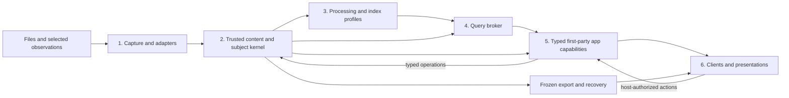

# Personal Information Modules and Installation Design

> **Status:** Informative architecture proposal, 2026-10-14. This document
> records a way to organize future personal-content capabilities and their
> installation choices. It adds no requirement, phase admission, schema, API,
> public ABI, runtime loader, service, database, or completion credit. Normative
> authority remains with the requirements and the [Core MVP Execution
> Plan](core-mvp-execution-plan.md).
>
> **Active context:** Phase 4 discovery architecture research and the separately
> admitted first-party client track. This proposal is reviewed against the
> [Driver and Processor Interface Requirements](../requirements/driver-and-processor-interfaces.md)
> and the presentation boundary in [ADR-032](build-stack-and-architecture-selection.md#adr-032-presentation-plane-extensions-with-a-closed-recovery-plane).
> It does not close either track.

> **Reuse-first correction, 2026-10-14:** these boundaries do not justify a
> module for every scenario. Prefer existing files, tags, Notes, supported
> search and takeout. A human-written date, location or ordered list can stay
> in ordinary content. Retain goals; compare the composed workflow with their
> actual user exits and review/add only necessary gaps. New domain semantics
> or integration needs admission rather than automatic rejection. The
> [closure plan](personal-information-product-closure-plan.md)
> supersedes a seven-milestone expansion with four bounded work packages.

## Product direction

Cairn should help one operator find personal information, use it through a
focused view, and take exact originals out. A user should be able to choose a
whole-client presentation suited to their habits while Photos, Music, and
future focused apps share one information foundation. Optional home-oriented
views could make selected content useful on a television, support bounded AI
assistance, or accept explicitly selected household-device observations. A
reminder could consume a due date found in an accepted document fact. Those are
information-use cases, not a request to turn Cairn into a household control
plane. This is a product direction only: household accounts, shared ownership,
device control, always-on sensing, and new media services are not admitted by
this design.

The trusted kernel remains the authority for exact byte identity, stable
subjects, provenance, accepted user facts, export, and recovery. Paths provide
source history and recovery projections; they are not the primary way to
organize content. Search and model outputs can help a person find an item, but
they do not establish exact identity, authorize deletion, or become an accepted
fact without the existing host-owned decision.

## Logical modules and physical deployment

### What information to retain

The owner may need both long-lived originals and information kept briefly to
resume a task. The usage horizon does not decide identity or grant deletion.
Distinguish information meaning before selecting an application or processor:

| Information | Current reuse and proposed meaning |
| --- | --- |
| Readable original files | Existing exact-content preservation, discovery and takeout, within the declared capture/read scope. Unknown format does not imply preview or semantic extraction. |
| Names, Notes, tags and sourced text | Existing durable records and search projections. New structured household facts or device observations need reviewed provenance, update and recovery semantics. |
| Chosen URL references | A user-authored or exported link record can already be preserved as an ordinary file. It preserves captured URLs/labels, not the remote page; dedicated capture, parsing and return UI remain future. |
| Task context | Why selected information belongs together and how to resume can be written in an ordinary file with shared tags/Notes. Human order stays in that content. A native ordered-link app is not needed for this recipe and remains an unscheduled idea, distinct from LinkGroup and SavedView. |
| Derived caches and indexes | Rebuildable computed aids under their existing lifecycle, distinct from originals and durable task/description records. Their retention cannot govern original deletion. |

The [task-context design](task-context-and-short-lived-information-design.md)
uses a reading/research tab group as the concrete example. Prefer explicit
user-selected tags/Notes to express resume or completion intent, without native
task states or expiry. Automatic deletion would need a separately reviewed
retention/recovery rule. A presentation choice does not grant it. Page body,
PDF, HTML or screenshot capture is a different capability from preserving a
URL list; it requires its own source and recovery contract.

### Ownership and topology

The following modules describe ownership and data flow. They are logical
boundaries inside the current product, not one service or package per box.

| Logical module | Responsibility and examples | Boundary / current footing |
| --- | --- | --- |
| 1. Capture and adapters | Present bounded source views; identify imported files and explicitly selected structured observations such as an exported calendar item or a user-selected device reading. | `CaptureDriver` is an existing contract. A future observation adapter would need an admitted source and fact contract. Arbitrary device streams or JSON blobs do not become household entities by ingestion. |
| 2. Trusted content and subject kernel | Exact SHA-256 plus logical length; stable subjects; source provenance; durable user Notes and tags; versioned description records and accepted facts; policy, export and recovery. | Current authority. The user-facing free-form surface is Notes, while durable annotation and description record types remain distinct where provenance and recovery require it. Model output remains a proposal unless accepted through an authorized host operation. |
| 3. Processing and index profiles | Extract text or media facts; create independently versioned text or image embeddings; build named rebuildable index generations. | Existing `Processor`, `IndexProvider` and `QueryProvider` seams. Each capability is optional except the required local BGE text profile in the personal default. Exact saving remains available if processing fails. |
| 4. Query broker | Run compatible providers against their named generations, authorize returned subjects, and fuse ranked subject-bound candidates with per-source provenance. | Host-owned query authority. Never compare raw vectors from distinct model spaces or merge scores without a declared fusion rule. |
| 5. Typed first-party app capabilities | Photos, Music, and later reviewed consumers such as an information-led home view, reminders, or a TV browsing surface. | Compiled first-party capabilities call existing typed operations and share host authority. Future apps require their own reviewed contracts; they do not imply a new backend service or durable domain model. |
| 6. Clients and presentations | Browser, focused client, television layout, shell, page, renderer, and palette choices. | Current browser has compiled first-party shells/pages and JSON color themes. Presentation packages admitted by ADR-032 are data-only and composed at build or install time. |

The physical profile remains one Go service, one SQLite catalog, one configured
content repository, and the current React host. Model and index paths come from
persisted configuration, never from the client process working directory.
Existing provider supervision or a separately admitted provider process may
remain an implementation detail where its contract requires it. This proposal
does not split modules into microservices, add another live metadata store, or
make Docker Compose a personal-profile dependency.

## Search spaces and evidence

The text and image paths share subjects, authorization, and a broker, but their
vectors remain in separate spaces:

* **Text semantic search:** the personal default uses the pinned local
  ONNX/BGE text profile with in-process zvec. Its vectors represent the pinned
  text embedding space.
* **Image similarity and text-to-image retrieval:** current code has a separate
  Chinese-CLIP profile (`OFA-Sys/chinese-clip-vit-base-patch16`) and host binding
  for image embedding and index generation. Text and image queries use the corresponding
  CLIP tower. The image path is `READY` only after its optional bundle is
  installed and a generation is verified; a profile identifier in code does
  not mean that the bundle is installed or enabled.
* **OCR:** current code has an optional `ocr.image.text.v1` extraction
  capability and PP-OCR detection/recognition ONNX bundles with digest
  provenance. Recognized text and segments feed existing extracted-text and
  segment search axes. OCR does not itself create visual similarity. Bundle
  readiness and a successful recognition run are separate states; real-engine
  execution was not verified in this audit.
* **Online and hybrid text embedding:** `local` is the default. `online` is an
  explicit profile with its own endpoint, credentials reference, egress and
  retention policy. `hybrid` queries separate local and online generations
  and fuses their subject-bound results. A failed local provider does not
  silently switch to online, and exact, lexical and structured search do not
  wait for either semantic provider.
* **Descriptions or captions:** an LLM-produced caption is a separately
  attributed description result, not an embedding and not a substitute for a
  CLIP image vector. It is an explicit processing choice and remains subject to
  the existing description and acceptance rules.

Each generation binds the model and runtime digests, tokenizer, preprocessing,
dimension, normalization and metric, capability/configuration profile, and
input provenance required by its contract. Changing these inputs creates a
new generation; it does not reinterpret old vectors or change exact identity.
When a query provider is unavailable, status and degraded search behavior stay
visible while lexical and structured retrieval continue. Search coverage is a
projection, not a user tag or another durable state store.

Source-aligned segments and processor provenance are used where the current
contracts actually supply them. A future video transcript, household
observation, or other modality would need a reviewed typed fact/extraction
contract before it is treated as searchable structured information. This
document does not define those schemas.

## Three package classes

Installation language should distinguish three different things:

1. **Capability and model bundles** supply reviewed backend algorithms,
   runtimes, model files, tokenizers, indexes, or processor dependencies under
   existing provider contracts. They declare license, platform, digest,
   dependency, resource, network and capability information. Existing
   capability-specific install routes remain capability-specific; this class
   does not imply a general backend plugin installer. Installing a bundle makes
   a capability available; it does not silently enable online access, publish
   derived facts, or make an unverified index ready.
2. **First-party apps** supply compiled domain behavior and typed host
   operations, such as Photos or Music and, after separate admission, a home or
   TV information app. Current apps are distributed as part of the first-party
   client and selected through its existing state; a future app needs a reviewed
   contract and distribution path. Apps use the shared catalog, subjects, query
   broker, Notes, annotations and export/recovery operations. The app owns its
   focused interaction; the host owns identity, reads, policy, and durable
   writes.
3. **Presentation packs** are data-only declarations for a supported host
   version range, namespace, render slots, palettes, and known renderer choices.
   ADR-032's narrow model admits or refuses a whole pack and composes it at
   build or install time. The running application executes no third-party code,
   and the pack has no access to content/recovery authority. A user choosing a
   pack does not install a processor or a new app capability.

These classes cannot stand in for one another. A model bundle is not an app;
an app is not a provider plugin; a presentation pack is not executable code or
a way to add an index. Today the browser ships two compiled shells, compiled
pages, and JSON color themes. User-installed whole pages are a future ADR-032
direction, not a current capability. No runtime third-party loader, public
kernel ABI, or plugin store is proposed.

## Installation choices and state transitions

Future user-facing setup should describe a small set of profiles, then show
what each choice adds and whether it is available. This is not a proposal for
one general installer across capability, app, and presentation classes. It
should not expose
internal service, workspace, entry, artifact, or generation IDs as normal
choices.

| Choice | Installs / enables | Result and limit |
| --- | --- | --- |
| Core personal library | Current daemon, one catalog/repository, lexical and structured discovery, required local BGE profile and official Photos/Music app surfaces. | Exact storage and recovery continue independently of derived processing. Semantic status is reported honestly if its dependencies are unavailable. |
| Add visual retrieval | Optional Chinese-CLIP bundle and its distinct image index generation. | Image similarity and text-to-image candidates become available only after install, compatibility checks, index build and generation verification. Removing the bundle may make that search unavailable until dependencies are restored or the generation is rebuilt. |
| Add OCR extraction | Optional PP-OCR detector/recognizer bundle and the existing extraction capability. | OCR text appears with source and coverage provenance after successful processing. Installation alone does not claim that any image has been recognized. |
| Select online or hybrid text search | Explicit online profile and its separate generation, alongside local in hybrid mode. | Show the endpoint/egress decision and credential reference. No automatic remote fallback or source-byte upload is implied. |
| Choose another client composition | Compiled built-in shell/page or, in a future admitted release, a compatible whole presentation pack. | Changes layout and navigation only. It does not add data, search dimensions, host operations, or recovery meaning. |
| Add a future home/TV app | A reviewed first-party client build/feature and its compatible presentation. | Could show selected existing content on a TV or consume accepted facts for reminders. Any new capture types, device integrations, or actions require separate admission. |

For any future install route, the user-visible lifecycle should distinguish
host compatibility, dependency/license resolution, staging, digest validation,
admission, configuration or build-composition change, derived-generation
construction, and final readiness. A route admits or refuses its declared unit
whole, then reports `READY`, `NOT_BUILT`, `UNAVAILABLE`, or a typed failure for
the actual result. Bundle installation, index construction, and live
recognition are separate milestones. Disabling or uninstalling a capability
must not delete content, accepted human facts, Notes, tags, export manifests,
or recovery records. If retained data depends on a decoder, its existing
dependency/retention contract still applies.

Current implementation has distinct routes: the fixed BGE/ONNX + zvec
semantic bundle installer; `cairn image bundle install --archive <local
.tar.gz>` for the Chinese-CLIP bundle, followed by restart and a separate image
index generation; and no general OCR install command identified in this audit.
OCR bundles are resolved from the configured `OCRBundleRoot`. These are not a
general package manager or app installer. Future offline bundle delivery and
host support need their own packaging and release evidence; they do not make
Linux or NAS qualification true by assertion.

## Concrete user cases

**Find a photographed receipt and its transaction facts.** The operator stores
an image. Exact bytes are protected first. If OCR is installed and selected,
the extraction processor can produce attributed text segments; lexical search
can find a merchant or amount. CLIP can independently retrieve visually
similar images after its own bundle and generation are ready. Those results
are fused by subject at the broker. OCR text, CLIP distance and a user-confirmed
tag remain distinguishable evidence. A model suggestion never silently
becomes a financial fact or authorizes deletion.

**Find a photo from a phrase, then open it on a television.** A text query can
produce candidates from the CLIP text tower, while a supplied picture can use
the image tower. Any text-BGE candidates come from a separate generation.
The broker joins authorized subject references and records each source's
contribution; it does not compare raw BGE and CLIP cosine values. A future TV
surface may browse those same results and request host-authorized bounded reads
of the same originals. It does not create another catalog or media gateway.

**Find an item and its location.** A future household-information application
could let a person search “passport” and see a reviewed location such as
“study, second drawer,” its source and confirmation time, plus a linked photo,
manual, or invoice. A later correction could make the new location current
while marking a long-unconfirmed location as possibly stale. The record,
history, and recovery semantics need a separate contract; this example does
not map an item to tags/Notes alone or define a new schema.

**Find a due date for a reminder.** A person can search a due date stated in
an accepted source. A future optional reminder consumer could use that
information only after separate review of its source, delivery, repetition,
acknowledgement, and expiry semantics; it is not an existing Cairn application.
If a future selected-device adapter contributes a temperature or battery
observation, it must be bounded, attributable and explicitly configured. The
content kernel stores accepted information; it does not operate appliances,
coordinate family accounts, or infer permission to monitor devices.

**Change the whole UI without moving information.** The operator selects a
compiled first-party shell and Photos/Music presentations using the shared
search, selection, inspector, Notes, player, and host actions. In a future
ADR-032 release, a compatible data-only presentation pack can be admitted
whole. A bad or incompatible pack is refused or falls back visibly; neither
choice changes the catalog, content identity, or recovery path.

**Take a subset to another device.** The user selects results in the host,
freezes an existing ExportManifest, then materializes and verifies the output
through the current supported route. A TV or home client can help choose the
subjects, but the host remains responsible for exact original access and
export. Presentation packs cannot alter that manifest or materialization.

Large-camera inspection, long audio playback, video indexing, and TV-specific
streaming may need separate bounded client/read contracts. The existing
Photos/Music client budgets remain in force; this architecture note does not
increase them. Curated albums and ordered durable playlists remain separate
from the minimal LinkGroup and its export semantics.

## Recovery, rebuild, and conflict behavior

| Event | User-visible outcome | Data and authority behavior |
| --- | --- | --- |
| Optional model missing or incompatible | Capability is unavailable; show the reason and retain generic search or browsing. | Exact content, Notes, accepted facts, and recovery continue. No silent switch to another embedding space. |
| New model/runtime/preprocessing profile selected | New named generation is built and coverage progresses visibly. | Old vectors are not relabeled; both remain distinguishable until ordinary generation lifecycle policy retires the old projection. |
| Index is corrupt or absent | Mark the relevant dimension unavailable/not built and allow rebuild from authorized source records. | Index is a projection, never recovery authority. Do not claim retrieval coverage until rebuild and verification complete. |
| OCR or description processing fails | Show per-subject failure/partial/unavailable status where the host exposes it. | Preserve readable exact bytes; keep prior accepted user facts and provenance. Retry only under existing operation rules. |
| Online provider fails | Report degradation and continue local/lexical/structured paths allowed by the selected profile. | Do not upload to another endpoint as fallback or use an online provider unless explicitly selected and authorized. |
| Two capabilities claim the same slot or incompatible profile | Refuse the conflicting contribution or require an explicit supported selection. | Never use registration order or last-loaded-wins to select a processor, query generation, app operation, or presentation. |
| App or presentation is disabled | Route to the generic host experience with a visible fallback where needed. | Disabling a view hides that view; it does not delete catalog facts, user notes, content or export/recovery references. |
| Capability removal would strand retained encoded data | Block removal or require the already-defined verified migration/retention path. | Preserve the decoder dependency closure required for exact restoration. Presentation choices have no such repository dependency. |

## Bounded order for future decisions

These are boundary questions for a concrete separately requested capability,
not a future delivery sequence. First determine whether a recipe over current
operations already meets the user result; review new capability only for a
demonstrated gap. No question below reserves effort or schedules an app:

1. Finish the currently admitted core and client work under the execution plan
   and their normative requirements. Record actual local capability and
   readiness separately.
2. For any new information source, first name its user task, exact source
   boundary, accepted fact owner, provenance, privacy/egress rule, and existing
   host operation. Keep the initial adapter bounded to selected data.
3. For any new retrieval dimension, state the distinct model space, pinned
   dependencies and preprocessing, index-generation inputs, broker fusion
   behavior, degraded state, and rebuild path. Do not fold a new dimension into
   the default profile through this document.
4. For any new first-party app, reuse shared typed operations and host-owned
   subject/search scopes; identify any genuinely new durable semantics before
   asking for a contract review.
5. For presentation packages, apply ADR-032's whole-admission and
   build/install-time composition boundary. Do not generalize it into backend
   plugin installation or runtime execution.
6. Qualify packaging, licensing, supported hosts, clean-install behavior,
   rebuild, export, and recovery through their governing release gates before
   describing an optional choice as shipped or qualified.

## Recorded decision

[ADR-042](build-stack-and-architecture-selection.md#adr-042-separate-capability-application-and-presentation-installation)
records these informative architecture choices: one shared
information/recovery authority; logical modules inside the existing physical
topology; separate capability/model, first-party app, and data-only presentation
package classes; and distinct generation-bound vector spaces fused only through
subject results. Household control, new observation schemas, media streaming,
runtime extension loading, and a public backend ABI remain outside that
decision. It changes no implementation admission or phase gate.

## References and evidence limits

* [Content-First Product Decision](content-first-product-decision.md) — audience,
  daily loop, shared information foundation and focused client direction.
* [System Architecture](../requirements/system-architecture.md) and
  [Driver and Processor Interface Requirements](../requirements/driver-and-processor-interfaces.md)
  — host authority, provider seams, query broker and generation binding.
* [Content Store, Views, and Export Requirements](../requirements/content-store-views-and-exports.md)
  — configured paths, local/online/hybrid semantics and exact recovery.
* [Plugin System Requirements](../requirements/plugin-system.md),
  [First-Party Client Experience Contribution Guide](client-experience-extension-guide.md),
  and [ADR-032](build-stack-and-architecture-selection.md#adr-032-presentation-plane-extensions-with-a-closed-recovery-plane)
  — compiled client ownership and narrow presentation-pack admission.
* [Single-Operator Experience-Pack and Theme Design](single-operator-experience-pack-design.md)
  — existing interface boundary and current compiled experience history.
* Current implementation references: [image bundle command](../../client/cmd/cairn/image.go),
  [image bundle operation](../../client/command/operations.go),
  [daemon image-provider binding](../../server/cmd/cairnd/main.go),
  [image bundle admission](../../server/internal/search/image_bundle.go),
  [image query provider](../../server/internal/search/image_provider.go),
  [Chinese-CLIP image tower](../../server/internal/processor/image_tower.go),
  [OCR extraction capability](../../server/internal/processor/ocr_text.go),
  [OCR indexing path](../../server/internal/search/indexer.go),
  [OCR bundle configuration](../../server/internal/processor/ocr_bundle.go),
  [online/hybrid provider binding](../../server/cmd/cairnd/main.go), and
  [separate hybrid spaces](../../server/internal/search/semantic_provider_online_hybrid.go).
  Relevant existing evidence includes [image query and generation tests](../../server/internal/search/image_index_test.go),
  [OCR extraction and search tests](../../server/internal/processor/ocr_search_test.go),
  and [hybrid routing tests](../../server/internal/search/semantic_provider_online_hybrid_test.go).

The local discussion record in
`dist/product-strategy-20261014/strategy-and-household-direction.md` keeps the
near-term order focused on useful large-photo/long-audio/original-takeout paths
and a complete mixed-content journey, then validates whole-interface habits
within existing shells. A household item-location module is only a candidate
after core/client convergence; AI assistance, reminders, Home Assistant input,
TV, and video remain separate future reviews. This note preserves that order
as context and does not admit or prioritize implementation work.

The CLIP and OCR readiness statements above reflect the 2026-10-14 code/status
audit: the image profile and daemon provider binding exist, but visual retrieval is ready
only with an installed bundle and verified generation; OCR has an optional
processor and local bundles, while a real-engine recognition run was not
verified in that audit. The current image-bundle install command is
`cairn image bundle install --archive <local .tar.gz>`; OCR has no general
install command identified in the audit. These are implementation evidence,
not a new admission or release qualification. The product/household discussion
source is retained outside the tracked repository at
`dist/product-strategy-20261014/strategy-and-household-direction.md`; it is
ignored build/distribution material and is named here for local provenance only,
not linked as repository documentation.
